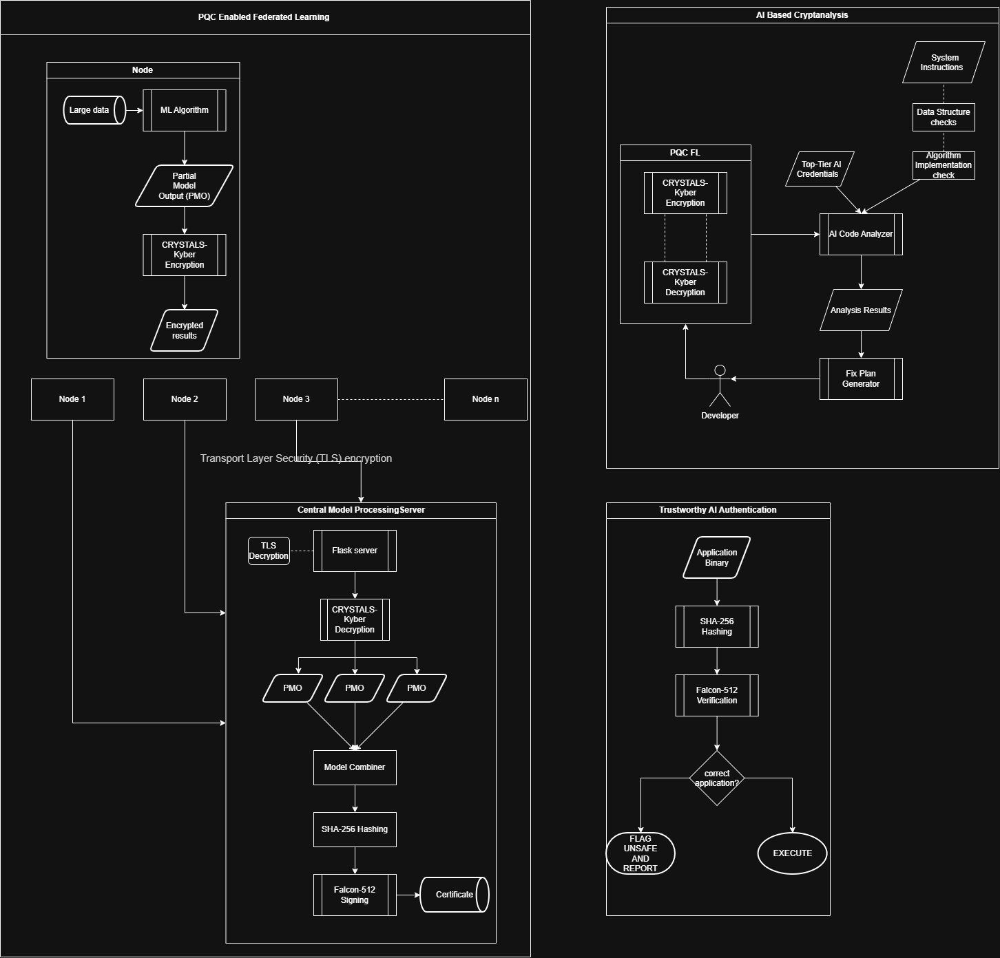

# post-quantum-federated-learning
1. PQC-Enabled Federated Learning
We train machine learning models locally across decentralized devices using partitioned datasets. Once local updates are finished, we securely transmit the weights and gradients to a central server using CRYSTALS-Kyber for encryption and decryption, protecting the transit against interception.

2. AI-Based Cryptanalysis of PQC
Before relying on these communication channels, we stress-test and evaluate our PQC algorithms using advanced AI models like Claude Opus and top-tier Gemini and ChatGPT versions. This involves simulating extreme conditions and automated cryptanalytic pressure to ensure the encryption primitives are completely foolproof.

3. Trustworthy AI & Authentication
Once the central server aggregates the final model, we generate its binary hash and use Falcon post-quantum signatures to create a secure digital certificate. We then provide a verification tool where users can check the authenticity of downloaded binaries, ensuring the model hasn't been tampered with or spoofed.

